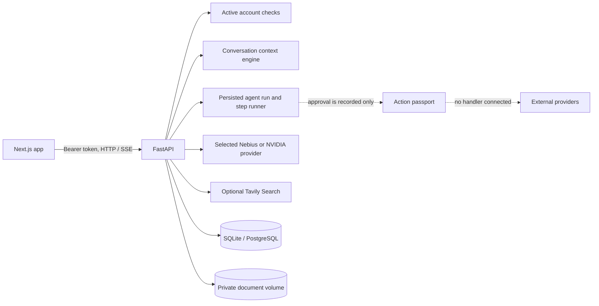

# Architecture

## Service boundaries

The Next.js browser application handles workspace views, forms, browser speech fallback, and authenticated requests. FastAPI owns authentication, validation, account scoping, database access, provider calls, research, document extraction, and agent execution. Provider secrets remain on the API side.

## Conversation lifecycle and context

`POST /api/conversations/{id}/messages` persists a user turn, then loads its account-owned conversation history. A client message ID is unique within that conversation; retries reuse the existing user/assistant pair instead of creating a second turn. Failed assistant replies can be retried against the same saved user turn.

The context engine retains a bounded recent message window, deterministic historical summary, and constraints extracted from messages. It adds matching user-visible memories, active missions, open commitments, lexical document passages, and saved research sources. The selected items carry IDs and provenance in context diagnostics. User messages are not appended twice to model history. Other AI endpoints do not automatically share this context engine.

Context matching is lexical and limited by per-category caps; it is not an embedding-based or semantic retrieval service. The application does not currently provide a separate Context Pack editor.

## Agent execution

Agent runs and ordered steps are stored in the relational database with lifecycle states and events. Tool arguments are validated against each registered tool's declared input schema. The registry currently includes Tavily search, account-scoped document search and Q&A, mission/task creation, artifact saving, and action approval recording. Read-only search tools can be retried; writes are not automatically retried. If a non-repeatable step is found interrupted or raises an ambiguous error, the run is blocked so the user can inspect the account before retrying.

Execution currently happens synchronously inside the API request. There is no durable queue or worker, and a blocked interrupted step does not have automatic outcome reconciliation. The API exposes pause, resume, cancel, and failed-step retry controls for persisted runs.

Approval changes an action passport state only. Google Calendar and Gmail have read-only browsing endpoints; there are no calendar/email write handlers, payment handlers, or travel booking handlers, and approval never reports execution or verification.

## Data and ownership

SQLAlchemy models and account-owned routes cover users, conversations/messages, missions and graph nodes, commitments/events, risks, action passports, memories, integrations, audits, agent runs/steps, documents/chunks, research sessions/sources, and artifacts. Protected reads and writes include the authenticated user ID. Conversation messages carry request idempotency keys; research source IDs are scoped to a research session to prevent cross-session primary-key collisions. Google Workspace OAuth credentials are encrypted with AES-GCM before storage; Gmail, Calendar, and Drive access is read-only and token material is excluded from status responses.

Document files use generated storage keys beneath `DOCUMENT_STORAGE_DIR`; filenames and extracted text are stored separately. Uploads have per-file and per-account bounds. Extraction supports PDF, DOCX, PPTX, XLSX, TXT, Markdown, and CSV. The vault does not perform OCR or embeddings, and there is no in-app binary preview.

The event bus uses process-local queues for SSE. Events are not durable across restarts and are not shared between API replicas.

## Research and providers

`lifeos/ai/provider.py` routes to the explicitly selected Nebius or NVIDIA model provider; it does not automatically switch based on available keys. Tavily requests are bounded and server-side. Research sessions persist normalized source metadata, snippets, retrieval times, synthesis, and citation IDs.

Citation validation checks that cited IDs resolve to sources saved for that session. It does not independently establish that the source supports a generated claim. The research UI states this limitation. Saved research can be reopened, deleted, converted to an artifact, or converted into a mission.

Travel endpoints provide official search links when provider credentials are absent. If credentials exist, the current adapters still do not call a provider API; responses report that inventory was not queried. Live offers, price revalidation, and direct booking are unavailable.

## Security and deployment

Protected routes require bearer tokens resolving to active users. Development may use an ephemeral auth secret, which invalidates tokens on API restart. Production configuration requires a 32-character signing secret, durable non-SQLite database URL, trusted non-local CORS origins, and debug disabled. The frontend stores the token in local storage; deployments should use HTTPS and an appropriate browser security policy.

Compose is for local development: PostgreSQL is health checked, API ports bind to loopback, and document originals use a named volume. No public hosting, deployment secrets, backup system, production database, or browser visual QA has been configured.
